# EverySearch — Búsqueda web y lectura de páginas con fuentes citables

<p align="center">
  <picture>
    <source media="(prefers-color-scheme: dark)" srcset="assets/hero-dark.svg">
    <source media="(prefers-color-scheme: light)" srcset="assets/hero-light.svg">
    
  </picture>
</p>

<p align="center">
  <a href="https://cursor.com/en/install-mcp?name=everyinfra&config=eyJ1cmwiOiJodHRwczovL2FwaS5ldmVyeWluZnJhLmNvbS9tY3AiLCJoZWFkZXJzIjp7IkF1dGhvcml6YXRpb24iOiJCZWFyZXIgPEFQSSBLZXk%2BIn19"></a>
  <a href="https://vscode.dev/redirect/mcp/install?name=everyinfra&config=%7B%22type%22%3A%22http%22%2C%22url%22%3A%22https%3A%2F%2Fapi.everyinfra.com%2Fmcp%22%2C%22headers%22%3A%7B%22Authorization%22%3A%22Bearer%20%3CAPI%20Key%3E%22%7D%7D"></a>
  <a href="https://github.com/everyinfra/everyinfra-agent-plugins/blob/main/i18n/README.es.md#claude-code"></a>
  <a href="https://github.com/everyinfra/everyinfra-agent-plugins/blob/main/i18n/README.es.md#codex"></a>
</p>

<p align="center">
  <a href="https://github.com/everyinfra/everyinfra-agent-plugins/stargazers"></a>
  &nbsp;<b>Dale una estrella al repo principal y recibe $1 de saldo.</b> <a href="https://everyinfra.com/es/docs?utm_source=github&utm_medium=readme&utm_campaign=everysearch-plugin&utm_content=star_line#quickstart">Cómo reclamarlo →</a>
</p>

<p align="center"><a href="README.md">English</a> · <a href="README.zh-CN.md">简体中文</a> · <b>Español</b></p>

> [!TIP]
> **Este repositorio contiene una sola skill: EverySearch.** El plugin completo de EveryInfra (10 skills, el servidor MCP remoto en `https://api.everyinfra.com/mcp` y la configuración para Claude Code, Codex, Cursor y VS Code) está en **[everyinfra/everyinfra-agent-plugins](https://github.com/everyinfra/everyinfra-agent-plugins)**. Los botones de arriba conectan el servidor MCP; la instalación del plugin en cada entorno está en el repo principal.

[Configuración](docs/setup.md) · [Flujo de trabajo](docs/workflow.md) · [Prompts](examples/prompts.md) · [Referencia de capacidades](docs/reference.md) · [Documentación de la API](https://api.everyinfra.com/docs) <sub>(en inglés)</sub>

<sub>Las cifras de la imagen salen del catálogo en vivo del 2026-10-24; la referencia es siempre el catálogo en vivo y el esquema de las herramientas.</sub>

EverySearch es una skill independiente de EveryInfra para buscar en la web y leer páginas a través de MCP. Elige un mecanismo de recuperación disponible, conserva las URL originales y deja claro cuándo una fuente está desactualizada o no se pudo leer.

Encontrar una página y leer una página conocida son tareas distintas. EverySearch lleva al agente a usar el mecanismo más acotado que sirva y a no repetir búsquedas de algo que ya encontró. Una lista de resultados ayuda a responder después, pero no es por sí sola una conclusión verificada.

## Qué puedes hacer

- Localizar la documentación vigente y conservar su URL original.
- Leer una página que te pasan con el mecanismo de lectura compatible.
- Buscar en un tema o sitio acotado sin cambiar en silencio el tipo de búsqueda.

## Instalación

Es un paquete independiente con una sola skill y un flujo de trabajo **MCP**; no es un servicio nuevo. Necesita un entorno de agente compatible y el acceso configurado que describe la [guía de configuración](docs/setup.md). Validar el paquete en local no demuestra que la API esté disponible.

Revisa el contenido del repositorio y luego instálalo en Codex. Estos comandos añaden un catálogo respaldado por GitHub, no un aval de ningún marketplace oficial:

```bash
codex plugin marketplace add everyinfra/everysearch-plugin
codex plugin add everysearch@everysearch-plugin
```

Para una copia local, cambia la fuente del primer comando por `.`. La [guía de configuración](docs/setup.md) también cubre Claude Code y la conexión al servicio, que va aparte.

Con el acceso configurado, prueba:

> Busca la documentación oficial vigente de esta función y devuelve las fuentes originales, con fecha cuando la haya.

Este primer prompt solo inspecciona o prepara. Revisa cualquier operación de pago o efecto externo antes de seguir.

## Cómo funciona

1. Descubre `everyinfra_search` e inspecciona la lista de herramientas y el esquema de parámetros vigentes.
2. Elige búsqueda para descubrir, o un mecanismo de lectura o rastreo compatible si ya conoces la URL.
3. Ajusta la consulta, el número de resultados y el sitio a lo que pide la tarea.
4. Revisa las fuentes, su fecha y los fallos reales; conserva las URL originales.
5. Cita la evidencia usada e indica qué vías de búsqueda salieron vacías o no estaban disponibles.

**Un buen resultado:** material relevante con URL utilizables y una indicación clara de alcance y actualidad. Un resultado vacío significa que no se encontró nada en ese alcance, no que el dato sea falso.

## Límites y seguridad

- Los mecanismos de búsqueda, semántica, académica, foros o lectura de páginas hay que descubrirlos; un README no garantiza ninguno.
- Repetir búsquedas por palabra clave no cuenta como una verificación independiente.
- Una página puede estar inaccesible o un resultado puede estar desfasado; dilo en lugar de rellenar el hueco con una respuesta inventada.

El paquete trae una sola skill: no concede permisos ni registra una segunda conexión MCP. No pongas credenciales en prompts, archivos del repositorio, capturas ni registros compartidos. Descubrir, ejecutar, cobrar y obtener un resultado externo final son estados distintos. Consulta la [política de seguridad](SECURITY.md).

## Preguntas frecuentes y validación

Las preguntas frecuentes, la comprobación sin conexión (`python3 scripts/validate.py`) y la guía para contribuir están en el [README en inglés](README.md#frequently-asked-questions).

Mantenido por [EveryInfra](https://everyinfra.com/es?utm_source=github&utm_medium=readme&utm_campaign=everysearch-plugin&utm_content=footer). Licencia [Apache-2.0](LICENSE).
