# EverySearch — Web search and page retrieval for source-linked answers

<!-- rq223-banner -->
<p align="center"></p>

<p align="center">
  <picture>
    <source media="(prefers-color-scheme: dark)" srcset="assets/hero-dark.svg">
    <source media="(prefers-color-scheme: light)" srcset="assets/hero-light.svg">
    
  </picture>
</p>

<p align="center">
  <a href="https://cursor.com/en/install-mcp?name=everyinfra&config=eyJ1cmwiOiJodHRwczovL2FwaS5ldmVyeWluZnJhLmNvbS9tY3AiLCJoZWFkZXJzIjp7IkF1dGhvcml6YXRpb24iOiJCZWFyZXIgPEFQSSBLZXk%2BIn19"></a>
  <a href="https://vscode.dev/redirect/mcp/install?name=everyinfra&config=%7B%22type%22%3A%22http%22%2C%22url%22%3A%22https%3A%2F%2Fapi.everyinfra.com%2Fmcp%22%2C%22headers%22%3A%7B%22Authorization%22%3A%22Bearer%20%3CAPI%20Key%3E%22%7D%7D"></a>
  <a href="https://github.com/everyinfra/everyinfra-agent-plugins#claude-code"></a>
  <a href="https://github.com/everyinfra/everyinfra-agent-plugins#codex"></a>
</p>

<p align="center">
  <a href="https://github.com/everyinfra/everyinfra-agent-plugins/stargazers"></a>
</p>

<p align="center"><b>English</b> · <a href="README.zh-CN.md">简体中文</a> · <a href="README.es.md">Español</a></p>

> [!TIP]
> **This repository holds one skill: EverySearch.** The complete EveryInfra plugin (10 skills, the remote MCP server at `https://api.everyinfra.com/mcp`, and setup for Claude Code, Codex, Cursor and VS Code) lives in **[everyinfra/everyinfra-agent-plugins](https://github.com/everyinfra/everyinfra-agent-plugins)**. The buttons above connect the MCP server; the per-host plugin installs are in the main repo.

[Setup](docs/setup.md) · [Workflow](docs/workflow.md) · [Prompts](examples/prompts.md) · [Capability reference](docs/reference.md) · [API documentation](https://api.everyinfra.com/docs)

<sub>Numbers in the image come from the live catalog on 2026-10-24; the live catalog and tool schemas are authoritative.</sub>

EverySearch is a standalone EveryInfra agent skill for web search and page retrieval through MCP. It selects an available retrieval mechanism, preserves original source URLs and makes freshness or access gaps explicit for source-linked answers.

Finding a page and reading a known page are different tasks. EverySearch guides an agent to choose the narrowest available retrieval mechanism, preserve source URLs and make a bounded request rather than repeatedly searching for information already located.

Use it when the immediate job is retrieving current information, reading a supplied URL or finding sources. The returned evidence can support a later answer, but a list of search results is not itself a verified conclusion.

## What you can do

- Locate current documentation and preserve the original documentation URL.
- Read a user-supplied page using the supported retrieval mechanism.
- Search a constrained topic or site without silently changing search semantics.

## Quick start

This is a standalone, one-skill **MCP workflow** package, not a new API service. It requires a compatible agent host and the configured access described in [setup](docs/setup.md). Local package validation does not establish live API availability.

Install the source repository in Codex after reviewing its contents. These commands add a GitHub-backed repository catalog, not an official marketplace endorsement:

```bash
codex plugin marketplace add everyinfra/everysearch-plugin
codex plugin add everysearch@everysearch-plugin
```

For a local checkout, replace the first command's source with `.`. [Setup](docs/setup.md) also covers Claude Code and the separate service connection.

Configure access once, then ask:

> Find the current official documentation for this feature and return the original sources, with dates where available.

This initial prompt is scoped to inspection or preparation. Review any paid operation or external side effect before proceeding. Claude Code instructions and Cursor packaging boundaries are in [setup](docs/setup.md).

## How the workflow works

1. Discover everyinfra_search and inspect its current tool enum and parameter schema.
2. Choose search for discovery, or a supported read/crawl mechanism for a known URL.
3. Constrain the query, result count and site scope to the task.
4. Inspect the actual returned sources, freshness and failures; preserve the original URLs.
5. Cite the evidence used and state which retrieval paths were empty or unavailable.

### What a useful result contains

Relevant retrieved material with usable source URLs and a clear statement of scope and freshness. Empty results mean the retrieval found nothing within its scope, not that the requested fact is false.

## When to use this skill

EverySearch owns retrieval. Research owns claim framing, source comparison and a calibrated conclusion. Use EveryData instead when the desired result is a supported structured platform record.

## Limits and safety

- Available search, semantic, academic, forum or page-reading mechanisms must be discovered; none is guaranteed by a static README.
- Do not relabel repeated keyword searches as an independent cross-check.
- A page may be inaccessible or a result stale; disclose that instead of filling the gap with an invented answer.

The package contains one skill and does not grant permissions or register a duplicate MCP connection. Never put credentials in prompts, checked-in files, screenshots or shared logs. Discovery, API execution, billing and a final external result are separate states. See [security](SECURITY.md).

## Frequently asked questions

### Should I search when I already have a URL?

Prefer a supported direct-reading mechanism. Search is useful for discovery or as an explicitly disclosed fallback when the page cannot be read.

### Does a search result prove a claim?

No. Inspect the original source and its date. Use the research workflow when you need to compare evidence and resolve contradictions.

### Are all search modes always available?

No. The live tool enum is authoritative. Report an unavailable mode; do not silently substitute a different mechanism.

## Validate and contribute

```bash
python3 scripts/validate.py
```

This offline check validates packaging, local documentation links, the single-skill boundary, metadata and fixtures. It does not send messages, allocate resources or verify a production account. [Contribution guidance](CONTRIBUTING.md) and [the release checklist](RELEASING.md) describe the remaining checks.

Source publication, tagged releases, official marketplace acceptance and live service verification are separate milestones. Maintained by [EveryInfra](https://everyinfra.com). Licensed under [Apache-2.0](LICENSE).
